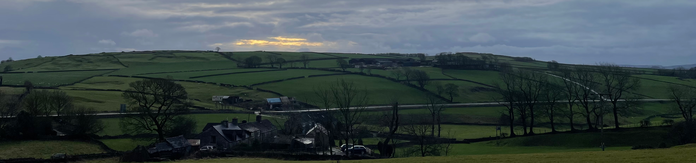

#Welcome to Sparrowpit Methodist Church

We are a friendly and inclusive rural congregation, enjoying traditional services and the well-known methodist hymns (if it's in parts so much the better)

Our regular services are at 2.45pm on the second Sunday of the month.

We are pleased to welcome our new minister Rev. Tim Morris.

Upcoming services:

| Date | Leader |
|------|--------|
| 19th April | Local Arrangement |
| 10th May | Rev. Tim Morris|
| 14th June | Anniversary Service |
| 12th July |  |
| 9th August |  |
| 13th September | Harvest Thanksgiving |
| 11th October |  |
| 8th November |  |
| 13th December | Decorating the Church for Christmas with Carol singing |
| 20th December - NB 6pm | Carol Service |
| 25th Dec | 6am Christmas morning service (start singing at the top of the village 5.30am) |

For up to date information on our services and events Like and Follow our [Facebook page](https://www.facebook.com/SparrowpitMethodist)

Read more about the [history](history.md) and [traditions](traditions.md) of Sparrowpit Methodists

